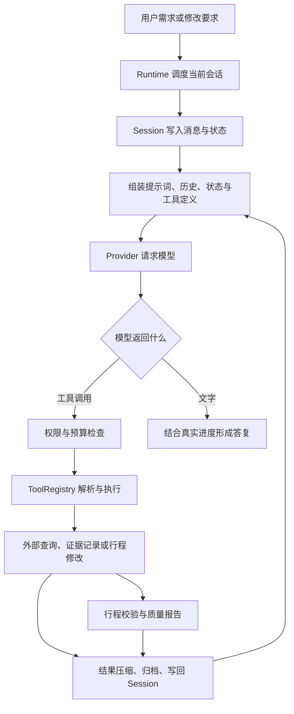

# minicode Agent 工程能力解析

整理日期：2026-11-07。依据当前工作区源码，包含尚未提交的修改。

更新提示：2026-11-09 已加入操作账本、主文件提交核对、派生导出恢复和 Bash 执行状态。下文关于旧多文件回滚与恢复缺口的分析保留当时背景；最新实现见 [工具提交与恢复](tool-execution-recovery.md)。

本文展开六个工程方向：执行控制、上下文管理、工具可靠性、状态一致性、数据处理、可观测与评测。每一部分都说明具体问题、原因、当前机制、取舍、验证与限制，最后给出项目经历的组织方法。

这里的“工程价值”指把模型接入一个有约束、有状态、有外部依赖的系统，并让系统行为可检查、可解释。现有机制及自动化测试不能直接证明项目的旅游规划效果优于 DeepSeek；后者需要单独进行受控对比。

## 一、先看整个系统在处理什么

用下面这份需求贯穿全文：

> 两位成人去西安玩三天，必去兵马俑、陕西历史博物馆和大雁塔，住同一家酒店，控制预算。生成后，用户又要求调整第二天下午的安排。

这是流程说明案例，不是一份已经查询并核实的真实出游方案。

一次执行大致经过：



需要先分清五种信息：

| 信息 | 用途 | 不能替代什么 |
| --- | --- | --- |
| 对话历史 | 记录用户与模型说过什么、调用过什么 | 不能代替当前有效行程 |
| 需求与旅行状态 | 保存日期、偏好、进度、当前版本等 | 不能证明某条外部信息真实 |
| 证据仓库 | 保存地点、路线、开放信息及来源关联 | 不能保证现实信息永不过期 |
| 行程文件 | 表达目前实际保存的安排 | 保存成功不等于质量通过 |
| 质量报告 | 表达某版本触发哪些规则 | 不能代替全部旅行体验判断 |

许多历史问题来自这些信息没有保持一致。例如：聊天里说“已安排三天”，文件里却只保存了一天；工具查到了驾车路线，行程中却使用公交；历史摘要只展示第一天，模型把后两天误当成没有安排。

工程工作就是明确这些信息之间的关系，减少依赖模型自行记住、猜测和协调的部分。

## 二、执行控制：让工具调用有边界，也能解释为什么停止

### 2.1 实际问题

模型可以连续要求搜索、读取、保存和校验。一次返回 Tool Calls，不代表它知道还需要执行几轮，也不代表它能正确判断任务是否完成。

在项目中，可能出现：

- 反复查同一景点，迟迟没有保存有效日期。
- 保存了部分行程，直接返回“规划完成”。
- 工具失败后换个说法继续请求，累计消耗越来越大。
- 外部程序帮助续跑时，错误地重置调用和费用预算。

因此，系统需要同时管理模型决策、任务进度和资源消耗。

### 2.2 当前调用链

`AgentRuntime` 管理会话调度、活动任务、取消、上下文压缩回调和预算续期。`ChatAgent.run()` 执行具体的模型—工具循环。

把当前逻辑简化，可以理解成：

```text
写入用户消息并保存检查点
循环：
  检查累计预算与停滞状态
  组装并检查完整模型输入
  请求模型
  如果返回文字：结合已保存进度形成答复，结束当前循环
  如果返回工具调用：
    记录 assistant 的 tool_calls
    检查权限、预算及重复调用限制
    执行工具并记录结果、错误和诊断
    压缩工具结果并写回 Session
    更新证据进展、交付进展和累计消耗
达到停止条件后：交付当前结果，并说明剩余缺口
```

这段是帮助理解的伪代码，细节以实际源码为准。

外层 Agent 当前逐个执行一轮中的工具调用；单个工具内部可能同时发起多个 HTTP 请求。例如一次景点查询会分别查询景区和博物馆。因此，“工具调用数量”和“上游并发请求数量”是两个问题。

### 2.3 预算为什么需要分层

| 预算 | 约束对象 | 当前含义 |
| --- | --- | --- |
| 当前工具轮次额度 | 一阶段的模型—工具往返 | 可以根据需求动态确定，也可以由宿主决定是否续期 |
| 累计轮数 | 整个任务 | 默认最多 150 轮 |
| 累计工具调用数 | 一轮中的多个工具分别计数 | 默认最多 300 次 |
| 累计 Token | 整个任务的模型消耗 | 默认最多 2,000,000 tokens |
| 费用预算 | 按模型价格估算的任务消耗 | 默认任务阈值为人民币 3 元，可配置 |
| 单次输入预算 | 一次模型请求 | 默认估算 24,000 tokens，与累计消耗不同 |

自动续跑共享同一个累计预算对象，不能通过重新进入循环获得一套新额度。

Token 和费用是在请求边界检查、按 usage 更新的。一次已经发出的模型请求可能让累计值越过阈值，因此估算费用阈值不能理解成供应商账单的精确封顶。

### 2.4 为什么还需要“无进展停止”

只设置 150 轮上限，会允许模型浪费很多轮。

当前进展至少分两类：

1. **相关事实进展**：已选或必去地点获得了新的可用资料。
2. **交付进展**：有效日期增加、关键问题减少、某日通过验收。

新增一批无关候选、相同内容重新保存、版本号增加，都不应该自动被视为交付进步。

当前实现会在连续无交付改进时收紧可选取证，给出定向提示；达到事实停滞或交付停滞条件后停止。源码中的主要阈值包括连续 12 轮无实际进展、连续 20 轮无交付改进；它们是现有策略参数，需要通过案例评测调整。

### 2.5 必须区分的三个结果

| 结果 | 含义 |
| --- | --- |
| 循环结束 | 这次执行不再继续调用工具 |
| 产物保存成功 | 当前版本已经持久化 |
| 行程验收通过 | 当前版本满足相应校验要求 |

模型返回文字可以结束当前循环，即使任务仍然有缺口。当前代码会结合真实保存进度纠正“已经完成”的答复，但不会无限追加生成直到通过。

普通 Runtime 的软预算续期由宿主策略决定；普通 live 评测有自动辅助续跑；新固定世界评测禁用追加补齐提醒和自动续期。比较评测结果时，必须说明使用了哪种执行策略。

### 2.6 工程取舍、验证与限制

- 提示词负责引导，预算与状态检查负责执行边界；仅靠“不要重复”很难约束全部行为。
- 停滞判断过敏会误停，过松会浪费资源，不能仅看版本号或文件修改时间。
- 取消信号可以中止后续请求，但已经成功保存的修改不会因此自动撤销。
- 会话恢复、文件检查点和精确恢复任意执行步骤是不同能力。当前不能宣称已经有完整的持久化工作流恢复系统。

相关验证见 `test/agent-tools.test.ts`、`test/runtime.test.ts`、`test/tool-budget.test.ts`。

源码入口：[Agent Loop](/Users/coolbloodfrog/minicode/src/agent/agent.ts:242)、[Runtime](/Users/coolbloodfrog/minicode/src/runtime/runtime.ts:171)、[累计预算](/Users/coolbloodfrog/minicode/src/core/execution-budget.ts:44)、[续期评估](/Users/coolbloodfrog/minicode/src/runtime/tool-budget.ts:79)。

## 三、上下文管理：让模型看到足够的信息，同时避免历史无限增长

### 3.1 实际问题

规划过程中，同一个信息可能多次出现：

- 搜索返回一批景点。
- 模型把所选景点写进 `save_itinerary` 参数。
- 保存工具返回状态和问题。
- `load_itinerary` 再读取同一份行程。
- 动态状态卡又展示其中一部分。

如果全部完整发送，历史会不断膨胀。相反，直接按字符截断，又可能删掉后几天、坐标、ID 或路线证据。

这里需要处理的是“模型当前需要看什么”，完整资料仍然需要保留在文件或仓库中。

### 3.2 完整请求是如何计量的

当前完整输入估算包含：

```text
系统提示词字符数
+ 历史消息及工具调用参数字符数
+ 临时状态、证据等注入字符数
+ 工具定义字符数
= 完整请求字符数

完整请求字符数 × 会话校准系数 + 协议开销估算
≈ 输入 Token 数
```

默认 24,000 是项目的输入工作预算，不是模型宣称的最大上下文容量，也不是字符数。

估算系数会参考模型返回的实际 prompt usage 校准。这个机制仍然是近似计量，不能等同于供应商 tokenizer 的精确结果。

检查发生在每次模型请求前。缩减或摘要后会重新构造请求；如果仍超预算，系统会明确报错，避免悄悄删掉全局约束后继续生成。

### 3.3 当前几种机制分别解决什么

| 机制 | 做法 | 是否使用 LLM |
| --- | --- | --- |
| 单次工具结果压缩 | 完整原文归档，返回结构化预览和读取入口 | 否 |
| 已完成工具轮次处理 | 归档旧调用参数，模型输入中移除对应的旧调用组 | 否 |
| 动态状态与证据选择 | 保留全局需求、日期进度，优先展开当前相关信息 | 否 |
| Context Epoch | 归档较早历史，用摘要替代，并保留最近调用组 | 是，当前摘要通路会请求模型 |

它们不是同一种“压缩”。工具结果压缩主要减少重复传输；Epoch 还会改变模型后续看到的历史表达，需要特别关注摘要遗漏。

### 3.4 为什么调用和结果必须成组处理

模型 API 需要 `assistant.tool_calls` 与对应 `tool` 结果保持配对。

如果只删除工具调用、保留结果，可能产生孤立工具消息，后续请求会被 API 拒绝。Epoch 选择保留边界时，会向前移动到完整调用组起点。

旧工具轮次的完整参数仍保存在本地审计信息中。模型输入不会继续展示压缩后的占位 JSON，避免模型把占位符当作可执行的新参数。

### 3.5 多日行程为什么需要“全局概览 + 局部详情”

项目曾遇到的问题是：第一天条目很多，预览预算先被第一天用完，后面的日期没有展示。

模型可能据此形成错误判断：后两天还没有保存，于是重排、重复查证或者覆盖已有内容。

当前读取采用分层视图：

- 全局概览覆盖所有请求日期，区分已安排、骨架、仅粗排、未保存。
- 查看某日时可以取得条目目录。
- 修改具体条目时，用真实日期与条目 ID 读取完整字段。
- 需要原始全量 JSON 时显式请求，并遵守结果交付预算。

概览空间不足时会整体减少字段，而不是按日期顺序丢掉后面的天数。

> 预览没有展示某天的详细条目，不能推出这一天没有安排。

如果一次局部读取没有完整交付，系统也不能把它记成“已经读过”。否则后续会同时出现读不到完整数据、又被阻止重新读取的问题。

### 3.6 工程取舍、验证与限制

- 原文归档提高可追溯性，但会带来磁盘管理、读取成本和过期文件清理问题。
- Epoch 的模型摘要可能遗漏或误写，因此关键约束和当前行程需要独立的结构化状态支撑。
- 不能保证一次压缩后模型就不会忘记；需要检查实际请求和后续行为。
- 压缩效果应同时看输入量、重复调用、漏日期和错误修改，不能只看压缩比例。

相关验证见 `test/context-policy.test.ts`、`test/epoch.test.ts`、`test/read-progress.test.ts`、`test/itinerary-overview.test.ts`。

源码入口：[完整输入计量](/Users/coolbloodfrog/minicode/src/context/request.ts:10)、[工具结果处理](/Users/coolbloodfrog/minicode/src/agent/tool-output.ts:43)、[Session](/Users/coolbloodfrog/minicode/src/core/session.ts:225)、[Epoch](/Users/coolbloodfrog/minicode/src/context/epoch.ts:180)、[全局概览](/Users/coolbloodfrog/minicode/src/tools/itinerary-overview.ts:13)。

## 四、工具可靠性：减少重复工作，并区分不同性质的失败

### 4.1 “重复调用”有多个层次

| 层次 | 例子 | 对应处理 |
| --- | --- | --- |
| 参数重复 | 同样的参数再次请求同一工具 | 查询缓存、并发相同请求复用 |
| 语义重复 | “闭馆时间”和“开放时间”重复查同一事项 | 参数规范化、事项状态 |
| 范围重复 | 同一中心缩小半径、改变 limit | 本地候选池重新筛选 |
| 证据重复 | 开放时间已经取得，保存时没有使用 | 证据绑定与状态提示 |
| 决策重复 | 已有足够信息，模型仍反复推理查询 | 进度约束、调用次数限制和停滞控制 |

只做 HTTP 缓存，只能改善其中一部分。即使没有再次联网，模型仍可能反复请求、接收大段旧结果、消耗 Token，却不推进规划。

### 4.2 当前注册表如何处理查询

简化后的执行顺序是：

```text
解析参数并检查工具是否存在
→ 补充目标城市等执行上下文
→ 规范化查询事项
→ 检查任务内次数、有效缓存与候选池
→ 可复用则返回缓存或本地筛选结果
→ 必要时进入真实工具实现
→ 工具访问供应商或网页
→ 记录数据来源、证据和查询状态
→ 返回结果及诊断信息
```

例如，查询对象中的“开放时间”后缀不应被当作地点名的一部分；开放与闭馆侧面的等价查询需要收敛到同一个事项。别名归一化依赖已核实的明确对应关系，不能随意把相似名字合并。

### 4.3 缓存、候选池、证据、已查状态为什么分开

| 对象 | 保存什么 | 生命周期与作用 |
| --- | --- | --- |
| 查询结果缓存 | 可复用的工具输出 | 常规旅行查询约 30 分钟有效，减少重复执行 |
| 原始候选池 | 已查询范围内的 POI | 有效期内改变筛选条件可本地处理 |
| 结构化证据 | 地点、路线、开放事实与来源 | 支撑保存与校验，不因查询缓存过期就全部删除 |
| 已查事项 | 查过什么、结果是什么状态 | 让模型知道已有结论与缺口，减少换词重搜 |

“30 分钟缓存到期”意味着可能需要重新请求，不能简单理解成此前所有事实失效。

证据也不是永久真理：地点信息更新、坐标改变、提取策略版本变化等，都可能影响已有绑定是否仍有效。

### 4.4 为什么必须区分查不到与查询失败

当前诊断中的主要查询状态包括：

- `verified`：取得当前规则支持的核验事实。
- `returned`：返回了数据或部分事实。
- `unavailable`：查询正常完成，但没有找到所需事实。
- `failed`：服务错误、验证拦截等导致查询未完成。

验证码页面可能返回 HTTP 200，但这不表示取得了有效开放信息。

如果把验证码当成“确定没有资料”再负缓存 30 分钟，系统会错误地阻止后续有效查询。因此，失败提示与正常无结果需要分别处理；任务内次数和重试预算仍然生效。

### 4.5 供应商侧的控制

高德客户端包含串行调度、限速、有限退避重试和错误码处理。共享闸门还要约束使用同一 Key 的本机多个进程。

- `10021` 属于并发/QPS 问题，可以在有限预算内退避重试。
- `10003`、`10044` 属于日配额问题，反复立即重试通常没有价值，需要熔断。
- 用户取消后，排队、重试和降级过程也应感知取消信号。
- 高德不可用时降级到 OSM，必须保留真实来源及失败原因。

这说明“工具没有抛异常”“HTTP 请求成功”“供应商业务成功”“取得所需事实”是四种不同结论。

### 4.6 工程取舍、验证与限制

- 规范化过度会合并不同事项，规范化不足会漏掉重复。
- 候选池只能复用已覆盖范围，不能把未查询区域当成已经查过。
- 次数限制可以止损，也可能在暂时失败后过早挡住有效请求，需要观察实际案例。
- 低证据引用率不一定代表浪费；候选选择本来就会淘汰一部分结果。
- 缓存命中率提高，必须同时检查最终完成度和正确性。

相关验证见 `test/tool-diagnostics.test.ts`、`test/discovery-pool.test.ts`、`test/travel-review-fixes.test.ts`、`test/amap.test.ts`、`test/amap-rate-gate.test.ts`。

源码入口：[ToolRegistry](/Users/coolbloodfrog/minicode/src/tools/tool.ts:176)、[查询规范化](/Users/coolbloodfrog/minicode/src/tools/travel-query.ts:22)、[证据仓库](/Users/coolbloodfrog/minicode/src/tools/travel-evidence.ts:92)、[高德请求](/Users/coolbloodfrog/minicode/src/tools/amap.ts:192)、[跨进程闸门](/Users/coolbloodfrog/minicode/src/tools/amap-rate-gate.ts:10)。

## 五、状态一致性：支持分批保存和局部修改，保持整份行程一致

### 5.1 为什么只保留聊天记录不够

连续生成和修改时，模型需要同时记住：

- 哪些日期已保存，哪些只是粗排。
- 哪些景点已经分配给其他日期。
- 哪家酒店正在使用。
- 哪些条目和路线证据属于当前版本。
- 用户是否真的授权了某个景点跨日重游。

如果这些约束只存在于历史对话中，历史压缩、长工具结果和多次修改都会增加不一致的概率。

### 5.2 当前状态如何组织

当前机制包括需求单、Session 中的旅行状态、已保存行程、日期粗排与景点分配、排除项、证据仓库以及质量报告。

已安排和预留的景点参与跨日分配检查。跨日重复是否被允许，需要从真实用户请求中解析授权，不能只相信模型传入一个 `allow_repeat=true`。

粗排预留也需要和实际保存同步：将某景点从第二天移走后，不能让旧预留永久占用它；已经保存的实际条目也不能被后来的粗排悄悄覆盖。

### 5.3 为什么默认增量保存

大行程经常按天形成。保存第二天时，如果默认整份覆盖，可能删掉已经保存的第一天。

当前 `save_itinerary` 默认增量合并，主要语义如下：

| 操作 | 语义 |
| --- | --- |
| 默认保存或 `merge=true` | 按日期与 ID 合并，保留未提交日期与条目 |
| `merge_mode=replace_day` | 有意替换某一天，删除该日未提交的旧条目 |
| `merge=false` | 显式整份替换，需要提供完整行程 |
| `expected_revision` | 检查当前版本，拒绝覆盖更新后的版本 |

局部修改依赖稳定 ID。已保存条目使用真实 ID；新增条目可以省略 ID，由程序生成。不能根据名字猜一个旧 ID 再发补丁。

下面只是补丁形状示例，实际 ID 必须来自当前已保存行程：

```json
{
  "title": "西安三日游",
  "merge": true,
  "expected_revision": 7,
  "days": [
    {
      "date": "2026-11-10",
      "items": [
        { "id": "读取到的真实条目ID", "end_time": "12:30" }
      ]
    }
  ]
}
```

系统先从旧条目恢复未提供的字段，再进行结构检查、证据绑定和完整校验。

### 5.4 局部修改仍然可能产生全局影响

假设用户把第二天下午的景点 A 换成 B：

1. 读取该条目的当前字段与版本。
2. 检查 B 是否已在其他日期保存或预留。
3. 删除或替换 A 不再适用的地点证据。
4. 检查前一站到 B、B 到后一站的路线。
5. 更新该日时间安排，并进行整体复验。
6. 保存新版本和相应报告。

修改单位可以小，但不能承诺任何修改都只影响一个条目。若 B 已在第三天，或用户改变了住宿、人数和总预算，就需要处理更大范围的依赖。

当前是规则驱动的增量处理与复验，不是一个已经具备完整依赖图求解的通用约束优化器。

### 5.5 路线为什么需要绑定身份

“A 到 B 有一条 40 分钟路线”需要至少和城市、起终点、交通方式、坐标、查询时间等信息关联。

如果把 A 换成 C，旧的 A→B 证据不能继续证明 C→B 可行。把公交改成步行，也不能沿用公交耗时。

当前保存会检查绑定关系；地点坐标更新后，旧路线也可能失效。路线查询、行程实际采用的方式、预留交通时段，需要相互对应。

### 5.6 文件持久化解决了什么，又没有解决什么

当前实现使用文件锁保护完整读—改—写过程，单文件通过临时文件和重命名进行原子替换。多个派生产物写入时，普通 I/O 失败会尝试回滚，JSON 最后提交。

这可以减少并发覆盖和半写文件问题，但不能宣称多个文件具有数据库级原子事务。断电或进程被强制终止时，派生文件仍有可能短暂不一致。

并发控制的两层作用也不同：

- 文件锁约束写入过程。
- 版本检查阻止旧页面或旧模型上下文覆盖新版本。

相关验证见 `test/itinerary.test.ts`、`test/travel-state.test.ts`、`test/visit-ownership.test.ts`、`test/route-contract.test.ts`、`test/planning-workflow.test.ts`、`test/itinerary-edit-errors.test.ts`，还应结合 Web 的版本冲突路径查看。

源码入口：[保存入口](/Users/coolbloodfrog/minicode/src/tools/itinerary.ts:51)、[增量合并与版本检查](/Users/coolbloodfrog/minicode/src/tools/itinerary.ts:195)、[局部编辑](/Users/coolbloodfrog/minicode/src/tools/itinerary-planning.ts:67)、[重游授权](/Users/coolbloodfrog/minicode/src/tools/repeat-visit-policy.ts:31)、[文件锁](/Users/coolbloodfrog/minicode/src/tools/plan-files.ts:16)。

## 六、数据处理：把外部描述变成有类型、有单位、有来源的信息

### 6.1 实际问题

旅游数据来自不同系统，表达方式不统一：

- 用户说“兵马俑”，地点库返回主景区正式名称。
- 一个景区下有多个子点，搜索把它们分别返回。
- 高德返回 `经度,纬度`，行程展示使用 `纬度,经度`。
- 有的路线返回秒和米，有的行程字段使用分钟和公里。
- 酒店价格按房晚计，预算却需要按人统计。
- 开放信息存在季节、星期、最后入场、临时公告等条件。

这些问题涉及实体识别、单位转换、条件规则与数据血缘，不能只依赖模型自然语言解释。

### 6.2 地点身份与包含关系

当前必去匹配支持规范名称、简称和明确对应的主景区，同时避免相似前缀造成误匹配。

主子景点归并依赖供应商父 POI 或明确名称关系。主 POI 保留自己的坐标、评分和证据；不能用一个高分子点替换主景区评分。

在行程中，主景区保存为一个主要游览条目，内部地点可以放入 `recommended_spots`。这样减少独立停留点和路线，也避免把参观几个展馆误当成去了几个互不相关的景区。

仅有一个子点，不应自动推断它能满足整个主景区的必去要求。没有明确归属时，也不能只凭距离近就归并。

### 6.3 坐标、时间和价格单位

| 数据 | 需要保存或检查的口径 | 常见错误 |
| --- | --- | --- |
| 坐标 | 纬度、经度及 GCJ-02/WGS84 等坐标系 | 经纬度颠倒，或者不同坐标系直接混用 |
| 路线耗时 | 明确秒还是分钟 | 把 2700 秒当成 2700 分钟 |
| 路线距离 | 明确米还是公里 | 把 1500 米当成 1500 公里 |
| 住宿参考价 | 每房每晚 | 当成人均费用，或者每天酒店锚点都重复计费 |
| 行程预算 | 人数、房数、实际晚数与人均口径 | 分批保存时提前误判最后一天 |

例如，假设每房每晚 320 元，两人住一间、共两晚：

```text
人均住宿费用 = 320 × 1 间 × 2 晚 ÷ 2 人 = 320 元
```

三天行程通常是两晚，末日回酒店或住宿锚点本身不自动增加一晚。这里还要遵守明确的 `stay_nights` 等覆盖信息。

地图展示与国内高德请求使用相应的 GCJ-02；OSM/OSRM 等来源按其坐标系转换，空间距离检查也要使用一致口径。

### 6.4 开放信息的完整处理链

```text
确定地点与缺失字段
→ 构造搜索词或使用已知入口
→ 获取搜索摘要
→ 摘要不足时读取相关正文
→ 识别参观指南、开放时间等导航
→ 提取具体字段及适用条件
→ 记录来源、引用原文、状态和采集时间
→ 按实际出行日期回填行程
→ 校验停留区间及明确冲突
```

`get_place_reviews` 目前同时承担口碑摘要与开放信息补查，名称不能完整表达其职责；文档和调用时应根据 `aspect`、`fields` 区分任务。

开放信息字段主要包括：时段 `hours`、闭馆规则 `closure`、最后入场 `last_admission`、场次 `sessions`、临时公告 `notices`。

只搜到官网首页，不能证明取得开放时间；提取到一个时间，也要检查它是不是票务办理时间、其他场馆时间或历史公告。

当前正文读取有请求预算、大小和超时限制，并对公开地址做校验。导航读取也是有限的，不会无限递归整站抓取。

### 6.5 证据可信度的边界

当前状态中的 `verified` 表示程序找到了提取规则支持、可以关联来源的表述。它不表示现实营业情况获得永久保证。

- 找不到资料，应保留未知或待确认。
- 确定的闭馆与行程冲突，应进入质量问题。
- 用户不需要为单纯缺少闭馆资料承担和“已知闭馆仍安排”相同的处罚。
- 来源等级和较早闭园选择可以降低部分风险，但不能处理全部条件化公告。
- 图片公告、动态渲染内容和复杂自然语言条件仍可能无法提取。

### 6.6 验证方式

重点验证“原始数据经过实际路径后是否仍正确”，不能只测试一个正则表达式：

```text
原始网页/供应商响应
→ 实际 ToolRegistry
→ 事实提取和持久化
→ save_itinerary 回填
→ 重新读取
→ 对实际出行日期执行校验
```

相关验证见 `test/opening-facts.test.ts`、`test/opening-page.test.ts`、`test/amap.test.ts`、`test/travel-review-fixes.test.ts`。真实网页 fixture 只能证明对应样本路径，不能直接推出全网覆盖率。

源码入口：[必去匹配](/Users/coolbloodfrog/minicode/src/tools/required-visits.ts:21)、[主子点归并](/Users/coolbloodfrog/minicode/src/tools/scenic-area.ts:15)、[坐标转换](/Users/coolbloodfrog/minicode/src/tools/coordinates.ts:5)、[开放事实提取](/Users/coolbloodfrog/minicode/src/tools/opening-facts.ts:100)、[导航识别](/Users/coolbloodfrog/minicode/src/tools/opening-page.ts:90)。

## 七、可观测与评测：知道哪里出了问题，也知道改动是否有效

### 7.1 为什么总调用数和一个总分不够

假设三日游调用 259 次，五日游调用 128 次，仅凭这两个数字无法知道：

- 哪个调用是在补充必要事实，哪个在重复读取。
- 是否一次工具内部发出了多次 HTTP。
- HTTP 200 是否携带供应商错误码或验证码。
- 行程是否完整，或者只是提前终止。
- 工具结果是否进入了最终行程。

同样，高分也不保证通过验收。总分、严重问题、完整度和主观偏好表达的是不同维度。

### 7.2 当前记录的执行信息

工具诊断将请求、执行、缓存复用、拦截、异常、HTTP 和供应商业务错误分开。通过异步局部上下文，把工具内部嵌套的网络请求归属到对应工具调用。

| 指标 | 用途 | 解释时的注意点 |
| --- | --- | --- |
| requested | 模型请求了多少工具 | 包含后续被拦截的请求 |
| executed | 进入工具实现的次数 | 工具内部仍可能有缓存或多个 HTTP |
| cache_hits | 复用已有结果 | 不等于模型已经正确理解和使用 |
| blocked | 被预算、重复等策略拦截 | 要看拦截是否合理 |
| HTTP 与业务错误 | 区分传输和供应商状态 | HTTP 200 不能直接算取证成功 |
| 查询状态 | 区分有数据、核实、无事实和失败 | 仍需要结合字段与原始返回判断 |
| 证据引用 | 返回证据有多少进入最终产物 | 候选淘汰会自然降低引用率 |
| Token、费用、耗时 | 观察完成任务的成本 | 失败早退不能被算作效率提升 |

对旧日志无法恢复的字段，需要保留未知，不能把没有观测到错误写成成功率 100%。

### 7.3 现有评测的层次

| 层次 | 当前能力 | 主要回答什么 |
| --- | --- | --- |
| 自动化回归 | 用测试覆盖实现与关键边界 | 已知程序行为有没有被改坏 |
| 离线行程评测 | 对已有文件运行指标和校验 | 行程是否符合当前规则 |
| 真实生成评测 | 用模型和工具实际生成，保存独立批次 | 这次完整运行能否交付 |
| 固定世界评测 | 本地固定外部事实，保留真实 Agent 与工具路径 | 相同外部条件下决策与实现有没有变化 |
| 主观质量盲评 | 尚未建立完整稳定机制 | 用户更偏好哪份合理行程 |

离线指标使用实际运行中的校验器，便于保持规则一致，也意味着两者可能共享同一个盲点。需要独立标注案例和额外事实对照。

### 7.4 新增的固定世界具体固定什么

当前首版西安场景固定：用户请求、出行日期、场景当前时间与时区、地点及别名、主子关系、开放信息、价格、天气、网页和 OD 路线表。

```text
真实模型自主决策
→ 真实 Agent / Session / Context / ToolRegistry
→ 实际工具的过滤、解析、证据与保存
→ 外部请求由本地场景响应
→ 原有校验 + 独立场景事实检查
```

响应按实体、范围、日期、分页和路线端点匹配，不要求新版复制旧版的工具调用序列。

场景运行使用独立缓存与文件目录，保存世界文件和源码指纹。明确已知无结果、故障注入、快照未覆盖查询，分别记录。未覆盖请求不会临时访问真实网络补齐，而是标记测试环境缺口。

当前独立检查主要覆盖日期、未知景点、明确闭馆日和开放时段冲突，尚未对全部路线、预算和现实事实做独立验证。

### 7.5 当前数据和成绩必须怎么解释

西安首版数据是人工构造的测试世界，包含 13 个地点和 66 条主地点间对称 OD 记录。开放时间、价格、天气、网页和路线耗时是模拟条件，不是实时采集结果；没有预设每天的行程答案。

自动化测试中的本地模型接口，负责验证工具调用—保存—评测整条链路。正式能力比较需要使用真实模型。

最近一次已有的完整回归记录为 734 项通过，类型检查和 lint 通过。该结果来自此前实现后的验证；本次文档编写没有重新生成旅游规划。

> 734 项测试通过，不表示生成了 734 份合格行程，也不表示已经证明新版优于旧版或 DeepSeek。

自动录制、脱敏、导入真实外部数据的完整流水线仍未实现。目前可以人工核对并整理为同一场景格式。

### 7.6 怎样判断一次改动的收益

建议保持同一场景、同一模型及资源上限，每版多次运行，再分别报告：

1. 首次自主完成情况、有效日期和必去要求覆盖。
2. 确定错误、严重问题以及尚未核实的信息。
3. 重复查询、证据利用和保存/修复行为。
4. 在可比完成质量下的工具、Token、费用与耗时。
5. 主观盲评的胜、平、负及具体理由。

| 对比结果 | 合理结论 |
| --- | --- |
| 质量与完成度相当，资源消耗下降 | 效率改善 |
| 确定错误减少，完成率提高 | 可靠性改善 |
| 调用减少但缺失日期增加 | 不能算效率改善 |
| 质量提高但成本也明显增加 | 需要报告取舍 |
| 世界覆盖不足或结果波动很大 | 暂时无法下结论 |

现有基线比较器仍先看总分，再看 P0/P1。这会让“分数上涨但新增严重问题”有机会被标成改善；本次新增固定世界时没有修复这个比较顺序，不能直接依赖其单一标签作结论。

相关验证见 `test/tool-diagnostics.test.ts`、`test/eval-metrics.test.ts`、`test/eval-run-store.test.ts`、`test/eval-external-world.test.ts`。

源码入口：[工具诊断](/Users/coolbloodfrog/minicode/src/core/tool-diagnostics.ts:77)、[行程指标](/Users/coolbloodfrog/minicode/src/eval/metrics.ts:62)、[固定世界](/Users/coolbloodfrog/minicode/src/eval/external-world.ts:123)、[独立事实检查](/Users/coolbloodfrog/minicode/src/eval/external-world.ts:304)、[当前基线比较顺序](/Users/coolbloodfrog/minicode/src/eval/baseline.ts:180)。

## 八、把工程工作讲清楚：问题、根因、方案、验证、限制

上面的六个方向是项目内容；下面五步是组织项目经历的方法。

### 第一步：描述可观察的问题

避免只说“工具调用效率低”，应说明可观察现象与后果：同一地点反复搜索、工具结果反复进入上下文、缺少日期却继续查可选口碑、用户需要反复指出问题。

如果使用调用数，要说明案例、版本、是否完整交付、是否包括缓存与被拦截请求。

### 第二步：解释有证据支持的根因

例如重复查询可能同时来自：等价参数没有归一化、查无结果没有进入稳定状态、旧调用组退出上下文后模型忘记结论，以及进度判断把无关候选算成进步。

需要用追踪、代码调用关系或可复现测试支持判断。工具没有异常不能证明上游成功；看到缓存命中也不能证明模型不再重复推理。

### 第三步：说明方案和取舍

例如采用查询规范化、30 分钟缓存、候选池本地筛选、已查状态索引和停滞约束。

同时说明边界：模糊别名不能随意合并；未覆盖区域不能冒充已有候选；失败不能当作确定无结果；次数限制可能误伤暂时性故障恢复。

### 第四步：说明验证依据

可以分三类讲：

- 实现测试：相同查询是否复用，过期是否重查，取消是否停止请求。
- 链路测试：真实 Registry、证据持久化、保存、重新读取能否保持一致。
- 效果评测：同一需求与固定世界下，新旧模型运行的完成度、错误和成本是否变化。

测试通过只能支持对应结论。一个真实样本可以证明该样本改善，不能直接写成所有城市成功率提高。

### 第五步：交代限制与下一步

例如：目前有固定世界运行通路，但真实数据自动录制还没有完成；有结构化状态和检查点，但没有完整的持久化任务恢复；有规则评分，但主观体验评估仍不充分。

明确这些边界，会让设计判断更可信，也方便说明后续工作的优先级。

## 九、可以如何概括这个项目

下面是一段按当前实现组织的表达，可以根据自己的实际参与和理解调整：

> 我把旅游规划作为一个有外部依赖和持续修改需求的 Agent 场景。系统需要管理模型与工具循环、累计预算、上下文输入、查询复用、行程状态和证据绑定。开发中遇到了重复检索、长上下文导致日期遗漏、路线证据与实际安排不一致等问题，分别通过查询状态、分层读取、增量保存和绑定校验处理。我也记录工具与 HTTP 的执行诊断，并补了固定外部数据的完整运行评测，用来减少前后对比中的环境干扰。目前工程回归已有覆盖，但真实规划成功率、相对通用助手的用户收益和主观体验仍需要进一步实测。

六个方向可以分别迁移到其他场景：

| 当前经验 | 其他 Agent 中的类似问题 |
| --- | --- |
| 执行控制与预算 | 代码修复、调研任务持续调用却不交付 |
| 上下文与归档 | 大仓库检索、长文档分析丢失关键内容 |
| 缓存、去重和限流 | 多 API 助手重复请求或触发供应商限制 |
| 增量保存与版本 | 文档编辑、工单协作发生旧版本覆盖 |
| 实体、单位和来源 | 财务、物流、研究资料混用口径 |
| 追踪与固定环境评测 | 难以区分模型变化、代码变化和服务波动 |

这些是可以由源码、测试和执行记录支持的工程内容。面向用户的优势，仍应通过实际节省的核对、整理和修改工作来证明。

## 十、阅读与复核入口

建议按需求选择阅读路径：

- 理解运行与预算：先看本文第二部分，再看 `agent.ts`、`runtime.ts` 和 `execution-budget.ts`。
- 理解重复读取与上下文：看第三、四部分，以及全局概览、Session、查询注册表。
- 理解行程修改：看第五部分，沿保存入口进入局部编辑、证据绑定和质量校验。
- 理解开放信息：看第六部分，沿搜索、导航、提取、回填顺序阅读。
- 准备展示或面试：先看第八部分五步，再从六个方向选两三个最熟悉的实例。

配套说明：[上下文与工具](/Users/coolbloodfrog/minicode/docs/context-and-tools.md)、[工具诊断](/Users/coolbloodfrog/minicode/docs/tool-diagnostics.md)、[固定世界评测](/Users/coolbloodfrog/minicode/docs/frozen-world-eval.md)、[开放信息来源](/Users/coolbloodfrog/minicode/docs/opening-sources.md)。

历史说明文档中可能保留旧规则或当时的测试计数。核对现状时，应以当前源码和对应版本运行记录为依据。
