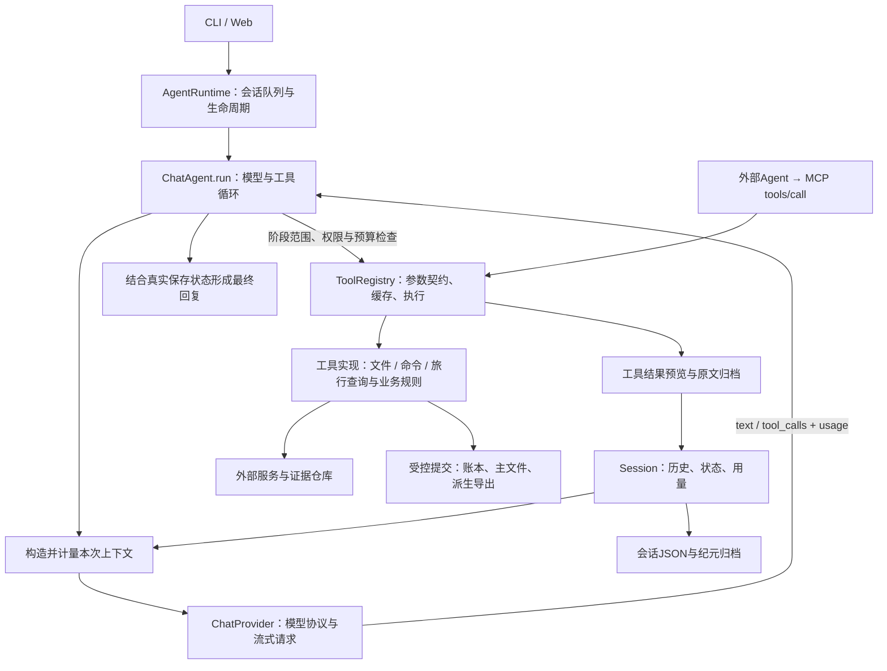

# minicode 核心架构与模块机制

按2026-11-10当前代码梳理，包含travel-v30的必去独立任务和统一工具参数校验。本文件描述已经实现的行为。

当前系统使用Node.js原生TypeScript运行，由项目自行实现Agent循环、会话、工具调度、上下文和持久化。运行时依赖包含Ajv，默认注册25个业务工具，另有3个Agent工具目录操作。

## 1. 总体调用关系



图中的“构造上下文”是逻辑职责，目前分布在agent、context和core几个目录，没有独立的ContextBuilder类。MCP共享工具实现和Registry，但不经过本项目的AgentRuntime、消息循环和上下文管理。

## 2. 入口与应用装配

| 入口 | 负责什么 | 主要代码 |
| --- | --- | --- |
| CLI | 终端输入、命令、流式展示、会话切换，装配Provider/Registry/Runtime/Store | [app.ts](/Users/coolbloodfrog/minicode/src/cli/app.ts) |
| Web | Node HTTP接口、SSE、聊天与地图界面、账号隔离、编辑行程 | [server.ts](/Users/coolbloodfrog/minicode/src/web/server.ts)、[index.html](/Users/coolbloodfrog/minicode/src/web/index.html) |
| MCP | 将工具schema暴露为tools/list，将调用转给Registry；stdio JSON-RPC | [server.ts](/Users/coolbloodfrog/minicode/src/mcp/server.ts) |
| Eval | 独立案例、真实模型/固定外部环境运行、验收和报告 | [main.ts](/Users/coolbloodfrog/minicode/src/eval/main.ts) |

CLI和Web通过Runtime驱动ChatAgent；live评测自己装配ChatAgent并提供预算和检查点策略，因此共用Loop，但不完全复用交互Runtime的执行策略。

SessionService目前只是会话持久化的薄封装，不是承担全部业务的应用服务层。Web中的很多装配、HTTP路由和事件处理仍直接位于server.ts。

## 3. Runtime / Scheduler：谁执行、何时执行

代码：[runtime.ts](/Users/coolbloodfrog/minicode/src/runtime/runtime.ts)、[scheduler.ts](/Users/coolbloodfrog/minicode/src/runtime/scheduler.ts)。

AgentRuntime保存sessionId到ChatAgent的映射，管理活动轮次、Abort、steer缓冲，以及事件、权限、预算续期和检查点回调。

- 同一sessionId通过Promise链排队，前一任务失败后后续仍能运行，防止两次生成并发修改同一会话历史。
- 不同会话可并发；这是进程内调度，不是跨服务的分布式任务队列。
- queue：作为下一次用户轮次执行。steer：当前轮正在运行时先缓冲，在下一次模型请求前写入user消息。
- steer到达太晚时转为下一轮，并沿用当前累计任务预算；取消时丢弃残余steer。
- Runtime解析软轮次预算，耗尽时结合质量评估调用宿主续期策略。CLI/Web的交互策略和评测的自动策略可以不同。

Runtime管理执行生命周期；具体“模型下一步要调用什么工具”由ChatAgent和Provider协作完成。

## 4. Loop：一次任务如何持续推进

代码：[agent.ts](/Users/coolbloodfrog/minicode/src/agent/agent.ts:249)、[execution-budget.ts](/Users/coolbloodfrog/minicode/src/core/execution-budget.ts)。

核心逻辑位于ChatAgent.run，按下列顺序运行：

1. 核对上一轮未回填的工具调用和提交结果，建立或复用累计预算。
2. 写入用户消息并保存检查点；无工具能力时降级纯对话。
3. 检查总预算、当前任务额度、停滞、取消与外部依赖阻塞。
4. 旅行模式下刷新证据和行程快照，选择当前必去/日期/层级任务，接收steer消息。
5. 构造历史、临时状态和工具定义，执行完整输入预算检查。
6. 调用Provider，消费文字或工具调用结果，并累计usage。
7. 若是工具调用：先记录assistant(tool_calls)及检查点，再逐个检查并执行调用，将结果配对写回tool消息。
8. 压缩工具输出、保存原文、更新状态与进展，再进入下一次模型请求。
9. 达到停止条件后交付当前版本、质量问题与缺口。

需要区分三个计数：用户turn、一次模型返回所形成的工具round，以及该批中的每一个tool call。一轮可以有多个调用，当前Loop逐个执行；单个工具内部仍可能并发请求多个外部接口。

模型返回文字时，旅行流程会核对真实天数和质量，必要时继续修订或用已提交版本生成答复。保存成功、Loop结束和strict通过是不同状态。

预算有三组：

| 预算 | 当前默认含义 |
| --- | --- |
| 单次模型输入 | 估算24,000 tokens，包括system、历史、临时消息和工具定义 |
| 整个任务累计 | 最多150轮、300次调用、2,000,000 tokens、估算任务费用3元，均可配置 |
| 局部任务 | 必去每次2轮/4次调用；可行性4轮/8次；时间路线8轮/16次；每目标或日期每层最多2次尝试 |

直接调用ChatAgent.run未传软额度时默认5轮；交互Runtime默认30轮，并可按行程需求配置。软额度与累计硬额度不同。自动续跑复用累计对象；新用户任务可建立新对象。费用按请求完成后的usage更新，属于估算阈值。

此外还有事实停滞、交付停滞和重复调用限制。增加无关候选、只改版本号和原样保存不会被当成交付进展。

## 5. Message / Session：保存了什么，什么发给模型

代码：[message.ts](/Users/coolbloodfrog/minicode/src/core/message.ts)、[session.ts](/Users/coolbloodfrog/minicode/src/core/session.ts)。

| 数据 | 机制与用途 |
| --- | --- |
| Message | 本地完整消息：id、role、content、createdAt、toolCalls、toolCallId、执行回执与审计参数 |
| PromptMessage | 发给模型的协议投影，去掉本地id、时间戳、执行元数据和审计副本 |
| ToolCall | id、name及原始JSON字符串arguments；结果通过toolCallId与其配对 |
| Session | 聚合消息、模型选择、工作区、审批模式、激活工具、旅行状态、Token用量、请求计量和epoch |

工具交互的基本协议是：

```text
user：提出任务
assistant：tool_calls [{id:"c1", name:"search_attractions", arguments:"..."}]
tool：toolCallId="c1"，工具结果或结构化错误
assistant：继续请求工具，或输出答复
```

一批工具完成后，旧调用的原始参数进入archivedToolCalls。toPrompt会同时移除旧调用和对应结果，避免孤立tool消息及历史参数占位符进入新请求。普通任务默认保留最近1批，旅行任务保留最近3批完整工具过程。审计历史与本次模型输入因此不同。

Session.toData/fromData负责序列化和恢复，不负责调用模型。旅行模式本身由宿主当前设置决定，不随旧会话恢复覆盖。

## 6. Context：每次请求的输入如何构造

代码：[request.ts](/Users/coolbloodfrog/minicode/src/context/request.ts)、[epoch.ts](/Users/coolbloodfrog/minicode/src/context/epoch.ts)、[travel-context.ts](/Users/coolbloodfrog/minicode/src/core/travel-context.ts)、[prompt.ts](/Users/coolbloodfrog/minicode/src/agent/prompt.ts)。

一次完整输入由以下部分组成：

```text
固定systemPrompt
  + 本轮选取的历史PromptMessage
  + 临时状态/证据/任务/已读索引等system消息
  + 当前允许使用的工具schema
```

默认固定提示词组合通用角色、旅行模式、日期、工作区、MINICODE.md规则和偏好。若配置非空customPrompt，当前实现直接使用它整体替换默认组合，而非追加。临时消息在每轮重新构造，不作为普通历史不断累积；它们的事实来源保存在Session状态或证据文件中。

当前上下文控制有四层：

1. **工具按需加载**：只发送常驻及已激活工具的完整定义，按阶段进一步收窄字段和日期范围。
2. **结果预算与原文归档**：单个工具结果默认最多3,000字符，一批最多8,000字符；超限原文写artifact，保留类型、路径和结构化预览。精确读取未完整交付时明确提示，并撤销已读状态，避免片段被当成完整数据回写。
3. **历史纪元压缩**：超过完整输入预算后，先归档旧Session，再通过不带工具的摘要请求压缩旧历史，保留最近安全消息组。不会将assistant(tool_calls)与其tool结果拆开。摘要请求的usage也计入预算。
4. **任务上下文切换**：旅行任务换日期或层级时，只保留用户要求和当前任务过程，额外提供全局占用、当前日条目、证据与相邻日边界。

输入计量包括固定systemPrompt、全部消息字符和工具schema，使用会话中的校准系数估算tokens，并用真实usage做EMA校准。超限时先摘要，再缩小动态内容和旧工具过程；仍超限则报错。24,000是工作预算，不是模型宣称的上下文容量。

当前没有向量库/RAG。长期信息主要靠结构化状态、实体证据、查询索引、文件原文和按需读取保留。

## 7. Tool：从模型参数到实际执行

代码：[tool.ts](/Users/coolbloodfrog/minicode/src/tools/tool.ts)、[tool-contract.ts](/Users/coolbloodfrog/minicode/src/tools/tool-contract.ts)、[activation.ts](/Users/coolbloodfrog/minicode/src/tools/activation.ts)、[all.ts](/Users/coolbloodfrog/minicode/src/tools/all.ts)。

Tool的基本契约是name、description、parameters、execute(args,ctx)，还有effect、outputKind和权限等元数据。execute的通用返回值目前是字符串；行程保存/读取另通过onItinerary回调传回结构化ItinerarySnapshot。

ToolRegistry负责注册表、工具定义导出、执行入口、证据仓库、查询缓存和在途请求复用。当前25个默认工具分为workspace 6个、travel-basics 4个、routing 2个、discovery 5个、itinerary 4个、traveler 4个。3个工具目录操作由Agent另外处理。

实际执行链：

```text
模型工具请求
→ Agent的任务范围、权限和累计调用额度检查
→ Registry解析JSON、应用明确兼容规则及上下文默认值
→ Ajv按工具schema校验
→ 核对待恢复操作，读取证据，检查查询缓存和查询次数
→ tool.execute(args, ToolContext)
→ 记录证据、查询状态与执行回执
→ Agent压缩结果并回填消息
```

默认生产工具顶层拒绝未知参数；第三方工具遵循自身schema的additionalProperties。兼容转换只处理已定义的同义写法，例如name/query→place、opening_hours→hours，以及需求单完整JSON编码的字符串数组。冲突、未知枚举和损坏JSON返回带参数路径的ToolValidationError，执行状态为not_committed/fix_arguments；转换记录可在Agent工具消息或MCP structuredContent看到。

schema检查结构，业务规则检查城市、实体、证据、日期和覆盖关系。工具参数错误仍占Agent的调用尝试预算，但不会进入外部查询的次数扣额或业务写入。

ToolContext由宿主注入workspace、AbortSignal、城市/需求、证据仓库、日期scope、operationId和状态回调。权限通过工具的requiresConfirmation/needsConfirmation与宿主onPermission回调决定；CLI/Web共享[permission-policy.ts](/Users/coolbloodfrog/minicode/src/service/permission-policy.ts)中的ask/edits/trust策略及会话批准记忆。

工具加载通过find_tools/activate_tools/deactivate_tools管理，每会话最多12个可选工具。旅行保存、读取、校验和逐日路线等工具按模式常驻。直接调用尚未激活的已注册工具时，Agent可自动激活；注册存在、已激活和本阶段允许是三个条件。

## 8. 旅行任务与进展控制

代码：[day-tasks.ts](/Users/coolbloodfrog/minicode/src/core/day-tasks.ts)、[planning-layers.ts](/Users/coolbloodfrog/minicode/src/core/planning-layers.ts)、[travel-progress.ts](/Users/coolbloodfrog/minicode/src/agent/travel-progress.ts)、[required-visits.ts](/Users/coolbloodfrog/minicode/src/tools/required-visits.ts)。

执行顺序为：先覆盖全部日期的基础outline，再处理未预留必去的独立识别任务，然后逐日核验可行性，最后逐日细排时间路线。

- 基础日期有内容且不重复后，允许继续后续工作；basic_complete仍额外要求必去分配，避免一个未识别目标锁死所有日期。
- 必去任务按稳定goal_id计数；日期任务按日期和层级计数，均记录pending/active/saved/blocked、重试、轮次、调用和失败原因。
- 必去保存必须覆盖当前目标，并保留另一已预留必去；预留不等于实际完成。
- 已保存详细日程有P0/P1时仍是draft，当前日期可继续修；其他日期在当前scope内保持。
- 更换基础景点会归档本日旧时间草稿，使受影响日期的后续层重新评估。
- 必去任务失败达到额度后，保留缺口，其他日期继续；最终strict仍会报告必去未满足。
- 程序按实际内容、证据和正式报告重算planning_layers和required_visit_goals，模型自填完成状态不能替代验收。

这部分策略已拆入若干模块，但任务选择、动态工具范围、进展判断和收尾仍直接接在ChatAgent.run中。当前是领域状态机配合Agent循环，没有通用DAG工作流引擎。

## 9. Evidence / Cache：真实数据如何进入行程

代码：[travel-evidence.ts](/Users/coolbloodfrog/minicode/src/tools/travel-evidence.ts)、[travel-query.ts](/Users/coolbloodfrog/minicode/src/tools/travel-query.ts)、[discovery-pool.ts](/Users/coolbloodfrog/minicode/src/tools/discovery-pool.ts)、[opening-facts.ts](/Users/coolbloodfrog/minicode/src/tools/opening-facts.ts)。

TravelEvidenceStore保存工具实际观察到的地点、路线、开放字段、包含关系和来源时间。模型参数不会直接成为已核验证据。保存行程时根据城市、名称和ID绑定真实坐标、来源、价格与路线数据，核验标记由程序回填。

三种复用需要分别理解：

| 数据 | 作用 |
| --- | --- |
| 查询结果与查询状态 | 约30分钟缓存；区分verified、returned、unavailable、failed。服务失败不冒充查无依据 |
| DiscoveryPool | 保存展示前的原始POI候选。缩圈、改数量或评分在本地重筛；不凭参数变化获取无限新候选 |
| 已采集证据 | 供行程绑定和复验。查询缓存过期不会简单删除已保存事实；开放字段另按日期、来源和有效性判断 |

相同规范化查询、同中心发现请求有次数限制，在途相同请求可合并。必去主实体缺失时可定向查询真实同城POI，不用附近子点冒充主点。

路线证据绑定起点、终点、坐标和交通方式；更换酒店或交通方式后不能沿用不匹配的旧证据。开放信息按hours、closure、last_admission、sessions、notices等字段分别保存状态和适用日期。真实主子点与地理区域关系分别记录；已取证父点可覆盖子目标，同区域独立子点不互相替代。

查询只增加证据，不直接提交已保存行程。将新路线应用到时间线仍需save/repair_routes；当前收尾逻辑会寻找能利用已有证据实际修复的日期，生成正常的保存调用，继续经过权限、预算和提交链路。

## 10. Itinerary / Validation / Commit：产物如何成为当前版本

代码：[itinerary.ts](/Users/coolbloodfrog/minicode/src/tools/itinerary.ts)、[itinerary-validator.ts](/Users/coolbloodfrog/minicode/src/tools/itinerary-validator.ts)、[managed-operation.ts](/Users/coolbloodfrog/minicode/src/storage/managed-operation.ts)、[plan-files.ts](/Users/coolbloodfrog/minicode/src/tools/plan-files.ts)。

save_itinerary主要执行以下闭环：

```text
读取已有版本与同标题需求单
→ 解析schema、按日期/稳定ID合并、应用edits
→ 检查任务scope与版本
→ 从证据仓库回填事实，按需复用真实路线修时间
→ 重算必去目标、分层进度和质量报告
→ 检查保存闸门
→ 通过操作账本提交主JSON和派生文件
→ onItinerary回调更新Session中的快照
```

默认增量保存保留未提交日期和条目；整天替换与整份替换需要显式参数。版本检查和文件锁保护读改写过程。Web地图编辑也进入同类保存/校验链路，不能只更新页面展示数据。

普通保存允许带问题的草稿，但P0以及重复占用、特定路线修复冲突等条件会拒绝；strict=true进一步拒绝P1。P2保留建议/待确认，严格通过不表示所有现实资料已确认。

主JSON是行程权威版本，Markdown、quality.json、quality.md是派生导出。操作账本先记录意图和请求hash，再原子替换主文件，核对提交结果并生成导出。相同operation_id的成功操作返回既有结果，不再次修改；结果未知或导出待重建时阻止盲目重放。

执行状态和业务副作用分开记录：execution_status为succeeded/failed/cancelled；effect_status为none/not_committed/committed/partial/unknown。取消或报错不自动等于已经发生的写入撤销。

## 11. Provider：模型协议边界

代码：[provider.ts](/Users/coolbloodfrog/minicode/src/llm/provider.ts)、[factory.ts](/Users/coolbloodfrog/minicode/src/llm/factory.ts)、[openai.ts](/Users/coolbloodfrog/minicode/src/llm/openai.ts)。

ChatProvider统一chat、chatWithTools及可选的流式/usage方法。Provider返回text或tool_calls，并附usage。OpenAI兼容实现负责HTTP、SSE片段合并、工具调用参数拼接、超时、有限重试、取消和用量归一化；DeepSeek经专用适配接入，未配置模型时可使用Mock。

固定systemPrompt由Provider在历史之外加入，因此上下文计量必须额外包含它。消息构造还会处理孤立tool和缺少回执的调用，保证发送协议合法；实际副作用核对由恢复模块承担，协议补位不代表重新执行工具。

Provider重试模型网络请求，Registry控制业务查询缓存，ManagedOperation控制业务提交恢复。这是三个不同层次的重试机制。

## 12. Storage / Config / Auth：不同数据各自保存在哪里

| 数据 | 默认逻辑位置 | 权威性与生命周期 |
| --- | --- | --- |
| 会话 | .minicode/sessions/*.json | 消息、状态和用量；安全边界保存，epoch前归档 |
| 行程 | plans/*.json | 实际已提交业务版本 |
| 需求单 | plans/briefs/*.json | 原始必去、日期、偏好等约束来源 |
| 质量文件 | plans/*.quality.json/md | 与行程版本对应的派生验收结果 |
| 工具长结果 | .minicode/artifacts/&lt;session&gt;/ | 原文与错误归档，按索引/游标读取 |
| 旅行证据 | .minicode/travel-evidence.json | 工具事实、来源和查询索引 |
| 操作账本 | .minicode/operations/ | 提交核对、重放判断和导出恢复 |
| 任务草稿 | .minicode/day-tasks/、planning-drafts/ | 被拒绝或已失效的草稿，不计完成度 |
| 模型与配置 | .minicode/config.json、models.json | Provider、价格、预算及模型Profile |
| 账号 | .minicode/users.db | Node SQLite保存用户与登录会话 |
| 评测 | eval/runs/&lt;run-id&gt;/ | 批次、attempt、Session、诊断、行程和报告 |

账号模式为每个用户建立独立的.minicode/users/&lt;user-id&gt;根及应用上下文，表中工作数据路径相对该用户根。外层HTTP处理登录后代理给该用户的内部应用服务。密码使用scrypt派生值，登录token在数据库中保存hash。

会话检查点和操作账本能恢复消息配对与提交事实，但不恢复任意函数的执行栈。Runtime队列、AbortController及累计预算对象主要在内存；自动续跑共享对象，不代表进程重启后拥有完整持久化工作流现场。

## 13. Eval / Diagnostics：如何定位失败

代码：[live.ts](/Users/coolbloodfrog/minicode/src/eval/live.ts)、[metrics.ts](/Users/coolbloodfrog/minicode/src/eval/metrics.ts)、[requirements.ts](/Users/coolbloodfrog/minicode/src/eval/requirements.ts)、[external-world.ts](/Users/coolbloodfrog/minicode/src/eval/external-world.ts)、[tool-diagnostics.ts](/Users/coolbloodfrog/minicode/src/core/tool-diagnostics.ts)。

评测覆盖四种运行方式：已有产物离线验收、真实模型联网生成、真实模型配固定外部世界、单元/集成回归。固定世界替换旅行HTTP响应和场景日期，保持真实Agent、工具解析、校验与保存，并单独报告快照未覆盖的请求。

live每个attempt使用独立目录和Session，记录模型、提示词版本/hash、套件快照、Token/费用、工具诊断、最终行程和失败原因。恢复批次会核对提示词，避免混合新旧版本。

业务质量报告之外，requirements独立检查景点上限、时间窗口、人数房数、固定酒店和避开目标等要求。执行了工具、生成了文件、详细日期齐全与strict通过分别记录。

ToolDiagnostics通过AsyncLocalStorage关联一条工具调用及其内部HTTP观测，区分executed/cache_hit/blocked/denied、错误类别、证据返回与引用、开放字段提取和保留。诊断数据保存到报告，不把全部遥测塞进模型上下文。

## 14. 当前模块边界与阅读顺序

当前最重要的数据边界是：Message记录发生过什么，Context决定本次看什么，TravelState记录当前执行摘要，Evidence保存工具观察，Itinerary JSON表达已提交安排，QualityReport表达验收结果。这几种对象不能互相替代。

从实现上看，通用循环和旅行调度仍在agent.ts交汇；上下文构造也跨越多个目录。ToolRegistry除执行外还包含旅行缓存和证据逻辑，工具通用结果仍以字符串为主。它已经具备明确的模块职责，但不是完全隔离的通用Agent内核与领域插件架构。

建议按以下顺序读代码：

1. message.ts、session.ts：理解公共数据契约。
2. provider.ts、tool.ts：理解模型和工具两端接口。
3. runtime.ts、agent.ts：串起执行生命周期与Loop。
4. request.ts、epoch.ts、tool-output.ts：理解输入与输出预算。
5. day-tasks.ts、travel-state.ts、travel-evidence.ts：理解旅行任务与事实流。
6. itinerary.ts、itinerary-validator.ts、managed-operation.ts：理解验收与权威版本提交。
7. eval/live.ts、eval/requirements.ts：理解真实端到端验证。
